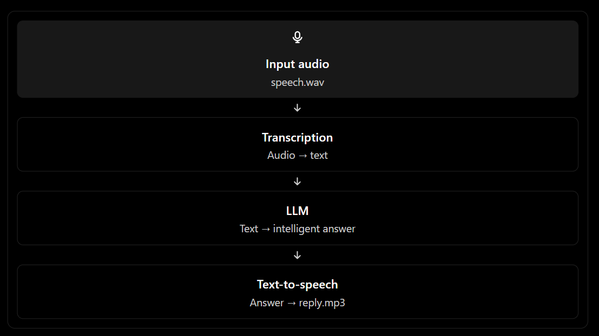

pip install openai ,
SDK concept: pip installs the OpenAI Python library, allowing us to use its OpenAI client and API methods.

Read the OpenAI docs while building the application, OpenAI SDK

 , architecture of voice assistant
